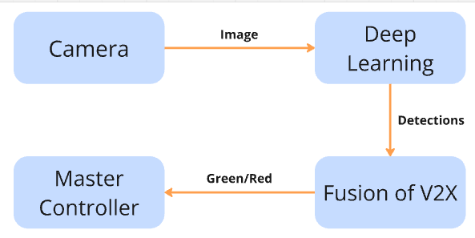
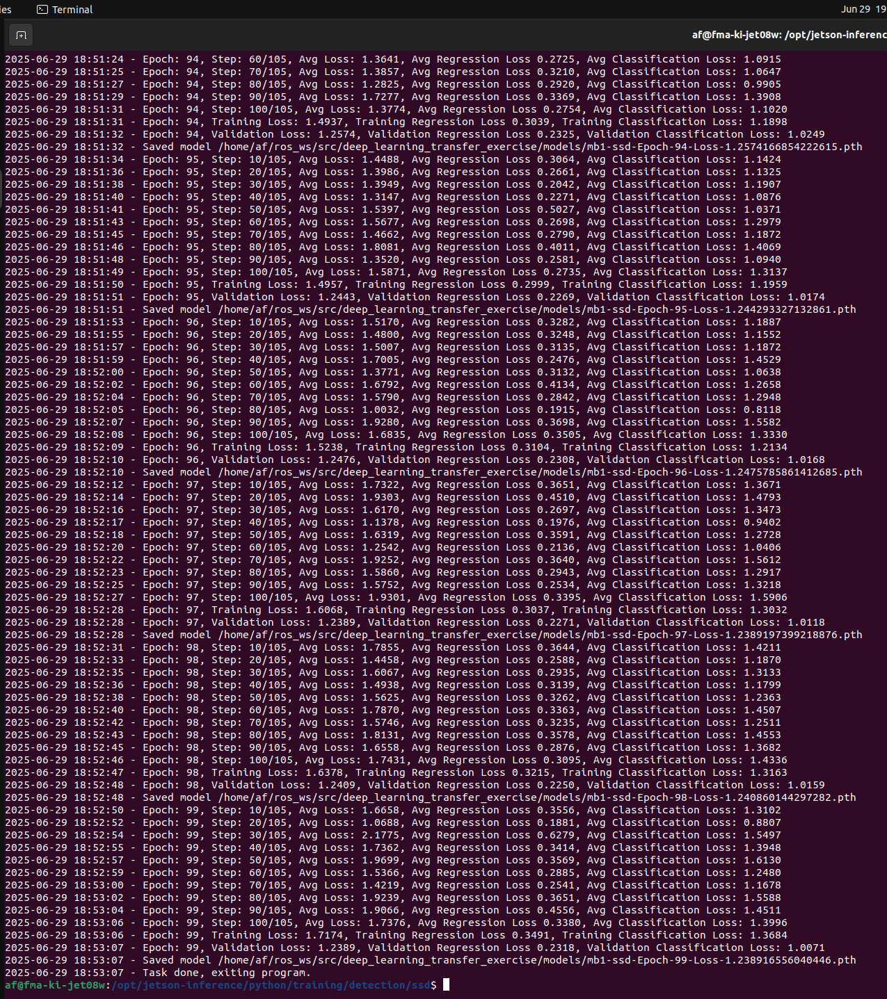
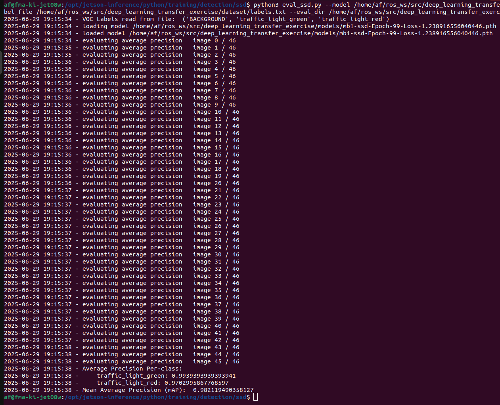
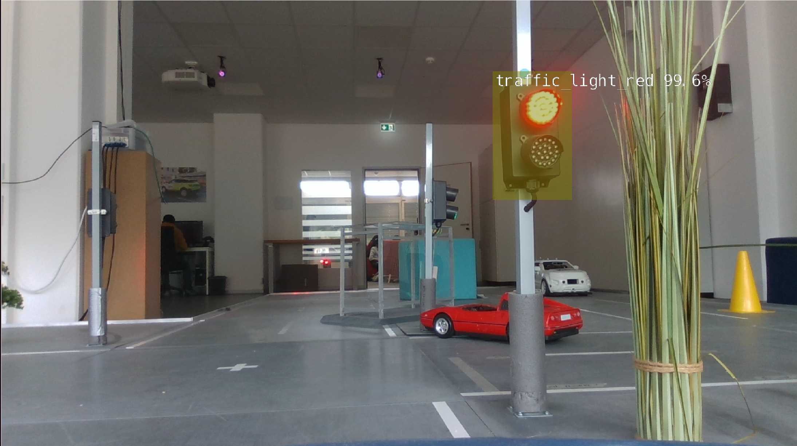
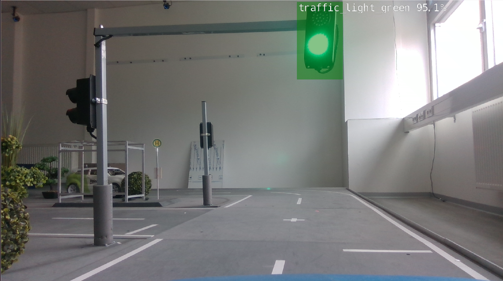

# Traffic Light Detection (SSD-Mobilenet)

Transfer learning-based object detection repository for real-time traffic light detection (`traffic_light_red` and `traffic_light_green`). This project implements an **SSD-Mobilenet V1** detector trained via transfer learning and deployed using **ros_deep_learning** as a vision-based fallback for autonomous driving systems when **V2X SPATEM** traffic signal messages are unavailable.

---

## 👤 Main Contributor

**Siddhant Anil Tilekar** ([@sid5224s](https://git.hs-coburg.de/sid5224s))

---

## 🧩 Component Description

This package provides a deep learning-based traffic light detection node integrated with **ROS** through **ros_deep_learning**.

During normal operation, vehicles receive signal phase information through **V2X SPATEM** communication. If SPATEM messages are delayed, lost, or unavailable, this module processes live camera frames, detects traffic light states, and supplies the detected signal state to the **Fusion of V2X** module, enabling continued decision-making for autonomous vehicle control.

### Key Highlights

- **Model Architecture:** SSD-Mobilenet V1
- **Training Strategy:** Transfer Learning
- **Dataset:** 1,000+ manually annotated traffic light images collected under diverse lighting conditions and viewing angles.
- **Target Classes:** `traffic_light_green`, `traffic_light_red`
- **Deployment Format:** PyTorch model exported to ONNX (`mb1-ssd.onnx`) for optimized inference using **ros_deep_learning**.
- **Performance:** Achieved **98.21% mAP@0.5 (IoU = 0.5)** on the held-out test dataset.

---

## 🗂 Table of Contents

- [Main Contributor](#-main-contributor)
- [Component Description](#-component-description)
- [System Architecture](#-system-architecture)
- [Installation](#installation)
- [Usage](#usage)
- [Model Performance & Evaluation](#-model-performance--evaluation)
- [Detection Results](#-detection-results)
- [Integration with V2X Fallback](#-integration-with-v2x-fallback)
- [License](#license)

---

# 🏗 System Architecture

The complete processing pipeline is illustrated below.

<p align="center">
  
</p>

### Processing Pipeline

1. Camera captures real-time traffic scenes.
2. Frames are processed by the SSD-Mobilenet detector using **ros_deep_learning**.
3. Detected traffic light states (`traffic_light_green` / `traffic_light_red`) are published on `/detectnet/detections`.
4. The Fusion of V2X module combines vision-based detections with V2X information.
5. The Master Controller receives the final motion permission (`True` / `False`) for vehicle navigation.

---

# Installation

## Workspace Setup

```bash
cd ~/ros_workspace/src
git clone https://github.com/siddhanttilekar/traffic-light-detection-v2x-fallback.git
```

## Build Environment

### ROS Melodic

```bash
cd ~/ros_workspace
catkin_make
source devel/setup.bash
```

### ROS 2 (Eloquent / Galactic / Humble)

```bash
cd ~/ros_workspace
colcon build
source install/local_setup.bash
```

---

# Usage

Launch the detection node:

```bash
roslaunch ros_deep_learning detectnet.ros1.launch
```

Ensure your ROS workspace has been sourced before launching.

---

# 📊 Model Performance & Evaluation

The SSD-Mobilenet detector was evaluated on a held-out test dataset using standard object detection metrics.

### Performance Metrics

| Metric | Result |
|---------|--------|
| Validation Loss (Final Epoch) | **1.2389** |
| Green Light Precision | **99.39%** |
| Red Light Precision | **97.02%** |
| Mean Average Precision | **98.21% mAP@0.5** |

### Training Progress

The figure below shows the final training epoch with the corresponding validation loss.

<p align="center">
  
</p>

### Evaluation Results

The evaluation output below reports the detector's performance on the held-out test dataset, achieving **98.21% mAP@0.5 (IoU = 0.5)**.

<p align="center">
  
</p>

---

# 📷 Detection Results

The following examples demonstrate real-time traffic light detection running on NVIDIA Jetson hardware.

| Red Traffic Light Detection | Green Traffic Light Detection |
|:---------------------------:|:-----------------------------:|
|  |  |

---

# 🔗 Integration with V2X Fallback

This node publishes inference results to the ROS topic:

```
/detectnet/detections
```

using the `vision_msgs/Detection2DArray` message type.

When V2X SPATEM communication becomes unavailable at an active halt zone:

- `traffic_light_green` → Motion Permission = **True**
- `traffic_light_red` → Motion Permission = **False**

This fallback mechanism ensures uninterrupted traffic signal perception and improves the robustness of autonomous driving systems during temporary V2X communication failures.

---

# License

This project is licensed under the **Apache License 2.0**. See the `LICENSE` file for details.
